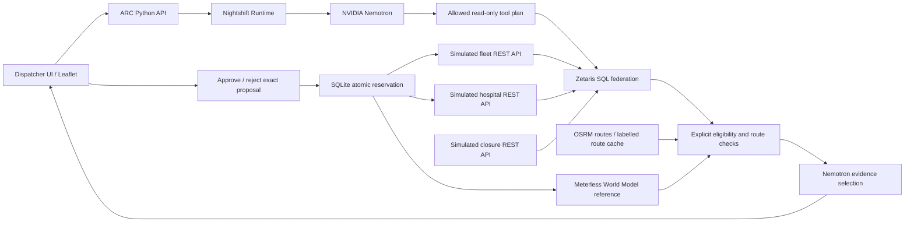

# ARC architecture

## Boundaries
- UI/API: loopback port 4317. No browser credential fields or provider secrets.
- Feed bridge: port 4318, read-only synthetic data only. Bound on all interfaces
  because Zetaris in OrbStack must reach host.docker.internal. Never put private
  patient or real fleet data on this demo feed. No write endpoints on this port.
- Zetaris: configured URL, organization and token from private environment.
  Only additive ARC_DISPATCH source registrations. Existing objects preserved.
- App mutation endpoints require JSON and enforce same-origin browser requests.
  This is a single-user local demo, not a multi-user hosted service.

## Decision policy
1. Require available ambulance and specified equipment.
2. Require predefined destination service, accepting status and a receiving slot.
3. Reject stale or missing operational evidence (120 seconds), or future timestamps.
4. Fetch both directed road-network legs, ambulance to incident and incident to hospital.
5. Reject any leg crossing a simulated circular closure. Affected routes are excluded,
   not dynamically rerouted around the circle. Another feasible pair may win.
6. Rank by total driving minutes, then more receiving slots, then stable pair ID.
   Without a traffic key, OSRM supplies static driving estimates. With a configured
   TomTom key, both legs use traffic-informed ordinary-driving routes requested
   for departure now. Transport is a current-conditions estimate, not a forecast
   after response and scene time. Traffic routes have a 30-second memory cache;
   selected route fetch times join the oldest-evidence approval clock. A configured
   provider failure does not silently fall back to static estimates.
7. Model selects evidence ordering and relevant explanations. Exact statements and
   numeric values come from the deterministic evidence ledger, never generated prose.
8. Approval requires the same state version, fresh evidence, open incident, available
   ambulance and slot. SQLite BEGIN IMMEDIATE serializes reservation and incident update.
   Any condition change invalidates proposals. A renewed recommendation needs approval.

## Real Meterless Engine
Vendored World Model reference pinned to upstream commit
1742dec56a66e58eef9dda2d2b865823758ca8cd, Apache-2.0. This is an actual upstream
engine implementation, not a label placed on SQLite. Node executes its TypeScript
using native transform support. The persistent subprocess serializes writes.

ARC ingests typed ambulance/hospital/incident entities with stable external IDs and
source provenance. Previous engine entity attributes are read before ingesting new
state and compared for accepting/status/slot changes. Recommendation entities relate
to incident and resources. The integration evidence view reads the engine event log.
Events survive app restart. Reset starts a new simulation epoch but retains history.
Reference scope: small deterministic implementation, JSON persistence, single writer.
Conformance command and product persistence/recall test are in scripts/check.sh.

## Data and routing
Fleet, incident requirements, hospital capabilities/status/slots and closures are
synthetic. Hospital/incident coordinates approximate Toronto locations. Nothing
represents clinical eligibility or validated dispatch protocols.

OSRM returns actual OSM road geometries and static driving durations. A 7-day cache
is explicitly labelled cached, with fetch times retained. No valid cache + routing
failure means no feasible routed assignment. No straight-line ETA substitution.

The local basemap is a cached partial Toronto Centreline extract (up to 6,000 road
features). It avoids external tile service dependencies. It is display geography,
not a routing engine. City road restrictions are optional public context, up to 100
records, with fetch time and cache/error status. They are not inferred as precise
closure polygons. A simulated closure controls the reproducible routing scenario.

## Failure behavior
Zetaris failure blocks the assessment, with no direct REST bypass. Nightshift failure
or invalid evidence references blocks a new AI assessment. Engine failure is visible.
No feasible destination or stale operational data returns exclusions and disables
approval. Scenario changes during an assessment discard its result. A model can
request only allowlisted read tools and cannot modify resources or execute SQL.

## Incident-scoped review and alternatives
State responses expose compact proposal and running-assessment metadata. The UI
stores results by incident/epoch, so background completion cannot overwrite the
selected case. Inference stays serialized to keep runtime load predictable.
An alternative request validates that the pair was eligible in the current proposal,
then performs fresh federation, route/eligibility checks and model explanation.
The chosen pair cannot bypass constraints. A new recommendation ID and approval
are required. Simulation scenario controls can explicitly target a selected case.

## Public incident synchronization and intake

PublicContext notifies Simulation after Fire/Police retrieval, and state reads
reconcile current freshness. Successful complete, fresh snapshots create cases;
stale/cached data never creates new ones. Fire uses published event numbers.
Police uses normalized occurrence time + published intersection, because OBJECTID
is rebuilt and is not a durable call ID. Categories are deliberately omitted from
that key so reclassification updates the existing case. No cross-agency fuzzy
merging or identity inference occurs. If a Police location/time changes enough
that its identity cannot be established, it may appear as a new case while the old
one is marked missing; the system does not claim certainty it lacks.

All Fire calls are ingested. New Police calls are limited to categories containing
collision, industrial accident, personal injury, injured or fire. Existing Police
cases continue updating if reclassified outside those categories. Published Fire
units are not interpreted as ambulance availability. Alarm level is not mapped to
medical priority.

Intake stores explicit dispatcher priority/service/equipment, pickup coordinates,
a pickup label and optional notes. Missing values remain null. An inline form and
map picker complete a case; assessment is blocked on the server before model or
routing calls when details are incomplete or the source needs review.

Public cases have incident_revision independent of the existing resource version.
New arrivals do not invalidate other incidents' pending plans. Category, location,
coordinates, alarm level, published time or feed-presence/freshness transitions
invalidate the affected case. Changes preserve dispatcher pickup overrides and
requirements. Analysis rechecks case revision and readiness after inference;
atomic approval checks them again. Dispatcher edits use optimistic revision
checking, rejecting stale forms. Unit availability and receiving-slot reservations
continue through the existing resource-version and SQLite transaction checks.

Existing state is migrated additively in its JSON payload; no reset is required.
The source snapshot and editable fields persist through restarts. Unsaved form
drafts survive case switching in the current browser session. Missing calls stay
in the review queue; there is no automatic resolution or external dispatch action.

## Autonomous coordination (October 23)

AgentCoordinator runs in the application process and observes state every three
seconds. Complete open incidents are prioritized by declared priority, arrival and
stable ID. It starts the existing allowlisted tool / Zetaris / route / World Model /
Nemotron evidence pipeline automatically. Case and resource changes trigger fresh
work; pending plans are refreshed from 80 seconds of evidence age, with the existing
120-second approval expiry unchanged. No automatic path invokes approval.

Higher-priority, fresh pending proposals create advisory unit and receiving-slot
commitments. These are not physical reservations. Lower-priority evaluations exclude
those units and account for those slots; the evidence ledger explains the claims.
A new conflicting higher-priority proposal invalidates affected lower proposals.
Approval checks current commitments again inside the SQLite reservation transaction.
A new assessment supersedes older pending assessments for the same incident. A
human rejection during an automatic refresh is respected instead of being replaced
by that refresh. Valid existing proposals remain approvable while background
refresh runs; approval changes the resource version so obsolete work is discarded.

The supervisor waits without inference when compatible resources are unavailable,
intake is incomplete, or an injected service/staleness condition blocks progress.
Actual service failures back off 30/60/120 seconds and surface an exception after
three failures on the same input fingerprint. An explicit retry or changed inputs
can restart work. No-feasible-route results are retried at most every three minutes
unless inputs change. A rolling in-process budget permits sixteen automatic starts
per ten minutes. Budget exhaustion resumes automatically; manual retries remain
explicit overrides. Attempt counters/budget are in memory and reset on app restart;
recommendations, reservations, agent enablement and prepared intake persist.

The agent can be paused/resumed from the map toolbar. Pause prevents new automatic
work while allowing an in-flight assessment to finish. The UI/API shows agent work,
awaiting approvals, resource waits, missing input, and recent agent events. Every
approval and rejection remains a dispatcher action.

## City isolation: Toronto and Seattle

The server owns one ARC instance per allowlisted city. Each instance has separate
SQLite resources/recommendations, public adapters, route caches, and World Model
process/storage. Seattle uses `data/seattle`; Toronto retains its existing paths.
A shared inference lock serializes Nightshift work across both cities. Each
workspace retains its own automatic supervisor and budget.

Every UI API request includes `?city=toronto` or `?city=seattle`; navigation reloads
the workspace so in-flight responses and browser drafts cannot change another
city. Selection and incident-source filters use separate session-storage keys.
Unknown city IDs fail validation. The feed bridge maps `/feeds/{kind}` to Toronto
and `/feeds/seattle/{kind}` to Seattle independently of query parameters.
Zetaris `ARC_SEATTLE` is additive; the Toronto namespace is unchanged.

Seattle's SODA adapter reads the last four hours using Seattle local time, retains
Pacific timezone offsets, and normalizes by durable incident number. Full
snapshots at the configured result limit are rejected rather than silently
truncated. Freshness uses the publisher's rowsUpdatedAt watermark as well as
retrieval time. Failed snapshots preserve cached data but block new ingestion.
Call disappearance requires review and never automatically resolves the call.
Seattle pickup bounds are checked both in the form/map picker and on the server.

Seattle resources use explicit SEA-prefixed IDs. Receiving capabilities, slots,
unit identities and locations are scenario inputs, with real approximate hospital
geography. The scenario controls, resource commitments, alternative selection,
state/revision checks, atomic approvals and evidence validation use the same
implementation as Toronto. No model-generated clinical triage is introduced.

## Workspace navigation performance

Live API responses remain `Cache-Control: no-store`; text/JSON responses use gzip
when requested. Static JavaScript, styles and local map extracts use content-based
ETags with mandatory revalidation, so switching cities reuses unchanged files and
source edits take effect immediately. The server caches encoded static assets by
file revision and accepts a larger navigation request backlog.

Initial state retrieval starts while the HTML's map scripts load. The incident
queue renders as soon as state arrives, independently of the selected proposal
request. Large cached street layers are constructed only when the online basemap
is delayed/unavailable; the fallback remains available for later failures.

Coordinator snapshots reuse one state/recommendation read. Incomplete and reserved
calls do not calculate resource commitments, and only cases with recommendations
can contribute commitments. Latest recommendation reads use an indexed epoch/case
lookup rather than decoding every historical route payload. Eligibility, proposal
freshness, city isolation and atomic approval checks remain authoritative.
